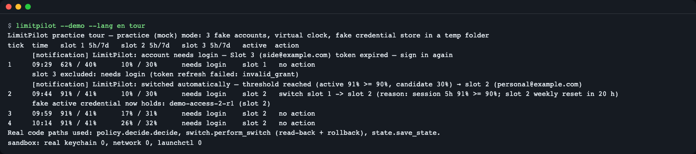
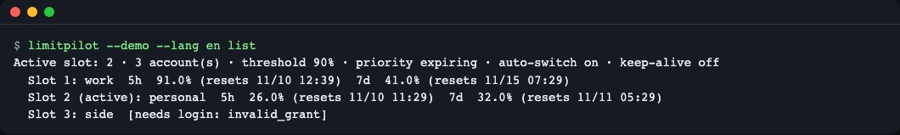
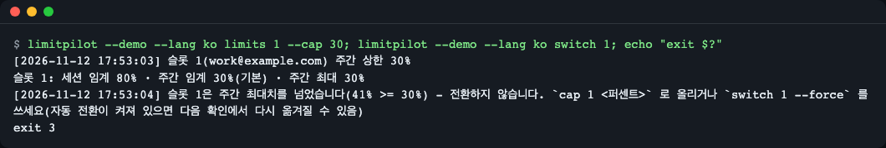
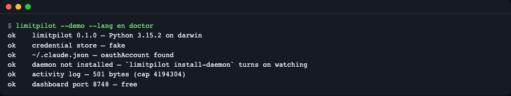
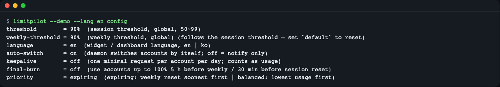
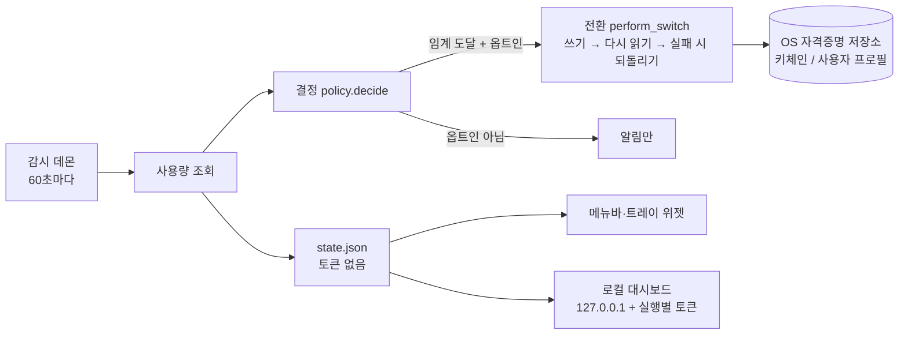
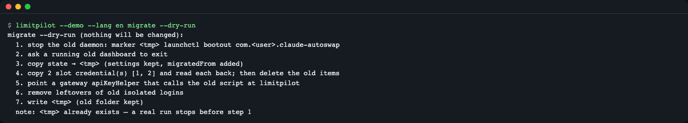

# LimitPilot

[English](README.md) | **한국어**

## 결과 미리보기


*연습용 목(mock) 모드 투어. 2번째 확인(tick 2)에서 5시간 사용률 91% 에 닿은 슬롯 1을 슬롯 2로 바꾸고, 다시 로그인이 필요한 슬롯 3은 후보에서 뺍니다. 마지막 줄은 실제 키체인·네트워크·`launchctl` 호출이 0번이었다는 확인입니다.*

## 한 줄 요약

**본인 소유의 Claude Code 구독 계정 여러 개의 남은 사용량을 한 화면에 모으고, 원하면 한도에 닿기 전에 다른 계정으로 넘겨 주는 데스크톱 상주 도구입니다.** 기본값은 알림만 보내는 것이고, 한도를 늘리거나 우회하지 않습니다.

이런 분께:
- Claude Code 구독 계정이 둘 이상이고, 한 계정이 한도에 닿을 때마다 로그아웃·로그인을 반복하는 분
- 지금 어느 계정이 얼마나 남았는지 메뉴바·트레이에서 바로 보고 싶은 분
- 자격증명(로그인 토큰)을 다루는 도구라서 외부 패키지 없이 코드를 직접 읽어 보고 쓰고 싶은 분

> 사용 전 [이용 시 주의](#이용-시-주의)와 [보안 메모](#보안-메모)를 읽어 주세요.

## 왜 필요한가

교통카드를 두세 장 들고 다닌다고 생각해 보세요. 개찰구에서 "잔액 부족" 이 뜰 때마다 지갑을 뒤져 다른 카드를 꺼내야 합니다. 각 카드의 잔액이 지갑 겉면에 늘 보이고, 잔액이 거의 바닥난 카드는 미리 뒤로 빼 두면 그런 일이 줄어듭니다.

Claude Code 구독 계정에는 5시간 사용 창과 7일(주간) 사용 창이 있습니다. LimitPilot 은 계정마다 이 두 창의 남은 양을 늘 보이게 하고(지갑 겉면), 원하면 거의 바닥난 계정을 다른 계정으로 바꿔 줍니다(카드 바꿔 넣기). 바꾸는 일은 "로그인 정보를 다른 계정 것으로 바꿔 쓰기" 이므로, 잘못 쓰면 로그인이 꼬일 수 있습니다. 그래서 바꾼 뒤 다시 읽어 확인하고, 다르면 되돌립니다.

## 설치

전제: Python 3.10 이상, macOS 또는 Windows. 메뉴바 앱은 macOS 에 들어 있는 `swiftc`, Windows 트레이는 Windows 에 들어 있는 `csc.exe` 로 내 PC 에서 직접 빌드합니다. 리눅스는 지원 대상이 아니며 CI 에서도 확인하지 않습니다.

```bash
curl -LsSf https://astral.sh/uv/install.sh | sh        # uv 설치(이미 있으면 생략)
uv tool install git+https://github.com/LeeGyeongPil/limitpilot
limitpilot --version
```
```text
limitpilot 0.3.1
```

설치 없이 저장소에서 바로 실행할 수도 있습니다(이 문서의 명령 앞 `limitpilot` 을 `PYTHONPATH=src python3 -B -m limitpilot` 으로 바꿔 읽으면 됩니다).

```bash
git clone https://github.com/LeeGyeongPil/limitpilot && cd limitpilot
PYTHONPATH=src python3 -B -m limitpilot --version
```

## 30초 실행 (연습용 목 모드)

`--demo` 는 **연습용 목(mock) 모드**입니다. 실제 계정 없이 도구가 어떻게 판단하는지 볼 수 있습니다.

```bash
limitpilot --demo --lang en tour
```
```text
LimitPilot practice tour — practice (mock) mode: 3 fake accounts, virtual clock, fake credential store in a temp folder
tick  time   slot 1 5h/7d   slot 2 5h/7d   slot 3 5h/7d   active  action
1     09:20  62% / 40%      10% / 30%      needs login    slot 1   no action
      slot 3 excluded: needs login (token refresh failed: invalid_grant)
2     09:35  91% / 41%      10% / 30%      needs login    slot 2   switch slot 1 -> slot 2 (reason: session 5h 91% >= 90%; slot 2 weekly reset in 20 h)
      fake active credential now holds: demo-access-2-r1 (slot 2)
3     09:50  91% / 41%      17% / 31%      needs login    slot 2   no action
4     10:05  91% / 41%      26% / 32%      needs login    slot 2   no action
Real code paths used: policy.decide.decide, switch.perform_switch (read-back + rollback), state.save_state.
sandbox: real keychain 0, network 0, launchctl 0
```

위 출력은 `[notification]` 알림 줄 2개와 임시 폴더 경로 줄 1개를 빼고 옮겼습니다. 시각은 실행한 때에 따라 달라집니다.

| | 연습 모드(`--demo`) | 실제 모드 |
|---|---|---|
| 계정 | 가짜 계정 3개(`work`·`personal`·`side`) | 내가 등록한 계정 |
| 자격증명 저장소 | 임시 폴더의 가짜 저장소 | macOS 키체인 / Windows 사용자 프로필 |
| 사용량 | 미리 만든 시나리오 파일(`demo/scenario.json`) | Claude 사용량 조회(네트워크) |
| 시계 | 가상 시계(한 번 확인할 때마다 15분 진행) | 실제 시계, 60초마다 확인 |
| 그대로 도는 실제 코드 | 전환 결정(`decide`), 전환·다시 읽기·되돌리기(`perform_switch`), 상태 저장 | 같음 |
| 바깥 호출 | 키체인·네트워크·`launchctl`·브라우저를 막고 횟수만 셈 | 실제로 호출 |

실제 모드의 첫 사용량 조회는 네트워크 왕복과 키체인 확인창 때문에 수 초~수십 초 걸릴 수 있습니다. 서버가 429(요청 과다)로 답하면 기다렸다가 다시 시도(백오프)합니다.

## 단계별 따라 하기

모두 연습 모드로 따라 할 수 있습니다. 앞 단계에서 만든 연습 상태(투어가 끝난 상태: 활성 슬롯 2)를 이어서 씁니다. 연습 상태는 시스템 임시 폴더의 `limitpilot-demo` 폴더에 있고(`LIMITPILOT_DEMO_ROOT` 로 바꿀 수 있음), `tour` 를 다시 실행하면 처음 상태로 돌아갑니다.

이 문서의 예시 출력은 영어 README 와 같은 화면을 보여 주려고 `--lang en` 을 썼습니다. 한국어로 보려면 `--lang ko` 로 바꾸거나 `LIMITPILOT_LANG=ko` 를 설정하세요(출력 문구만 한국어로 바뀌고 명령은 같습니다).

### 1단계 — 계정별 사용량 읽기

```bash
limitpilot --demo --lang en list
```
```text
Active slot: 2 · 3 account(s) · threshold 90% · priority expiring · auto-switch on · keep-alive off
  Slot 1: work  5h  91.0% (resets 11/10 12:30)  7d  41.0% (resets 11/15 07:20)
  Slot 2 (active): personal  5h  26.0% (resets 11/10 11:20)  7d  32.0% (resets 11/11 05:20)
  Slot 3: side  [needs login: invalid_grant]
```


*`list`: 슬롯마다 5시간(5h)·주간(7d) 사용률과 리셋 시각, 활성 슬롯 표시*

무슨 뜻인지:
- **슬롯**은 계정 하나를 저장해 둔 칸입니다. `(active)` 는 지금 Claude Code 가 쓰는 계정입니다.
- `5h 91.0%` 는 5시간 사용 창의 91% 를 썼다는 뜻이고, `resets` 는 그 창이 비워지는 시각입니다.
- `needs login` 은 저장된 토큰을 더는 쓸 수 없어 다시 로그인해야 한다는 뜻입니다. 이 계정은 자동 전환 후보에서 빠집니다.

### 2단계 — 상시 감시 켜기(연습)

실제 모드에서는 `install-daemon` 이 OS 스케줄러(macOS launchd, Windows 작업 스케줄러)에 60초 감시를 등록합니다. 기본은 **알려만 주고 전환하지 않는** 모드이고, 자동 전환은 `--enable-auto` 로 따로 동의해야 켜집니다. 연습 모드는 아무것도 등록하지 않고 할 일만 알려 줍니다(종료 코드 0).

```bash
limitpilot --demo --lang en install-daemon --enable-auto
limitpilot --demo --lang en uninstall-daemon
```
```text
Practice mode: would register the background watcher with the OS scheduler (nothing was changed) - auto-switch turned on in the practice state
Practice mode: would remove the background watcher from the OS scheduler (nothing was changed)
```

감시가 지금 무엇을 할지는 `auto --once --dry-run` 으로 한 번만 확인할 수 있습니다. 종료 코드 2 는 "할 일 없음" 입니다.

```bash
limitpilot --demo --lang en auto --once --dry-run
```
```text
[2026-11-10 09:22:41] No action: below threshold (session 26%/90% · weekly 32%/90%)
```

`session 26%/90%` 는 "활성 계정의 5시간 사용률 26%, 전환 기준(임계) 90%" 라는 뜻입니다.

### 3단계 — 계정마다 한도 따로 정하기

전체 임계(`threshold`) 말고 계정마다 세션 임계·주간 임계·주간 최대치를 따로 줄 수 있습니다. **주간 최대치(`--cap`)** 는 "이 계정은 주간 사용률이 이 값을 넘으면 자동 전환 후보로 쓰지 않는다" 는 안전 상한입니다. 슬롯 번호를 지정한 수동 `switch N` 도 그 슬롯이 이미 최대치를 넘었으면 경고하고 멈춥니다(종료 코드 3). 그래도 전환하려면 `--force` 를 붙이고, 대시보드는 "그래도 전환" 확인 창을 띄웁니다.

```bash
limitpilot --demo --lang en limits 1 --session 80 --cap 70
```
```text
[2026-11-10 09:20:33] Slot 1 (work@example.com) weekly cap 70%
[2026-11-10 09:20:33] Slot 1 (work@example.com) limits changed: session 80% · weekly 70% · max 70%
Slot 1: session threshold 80% · weekly threshold 70%(default) · weekly max 70%
```

이미 등록된 계정을 다시 등록해도(토큰이 만료돼 다시 로그인한 경우 등) 토큰만 바뀌고 별칭과 계정별 한도는 그대로 남습니다. 연습 모드의 `add` 는 지금 활성인 슬롯 2를 다시 등록하므로 `updated` 가 나오고, 다른 슬롯의 한도도 건드리지 않습니다. 같은 슬롯에 한도를 정한 뒤 다시 등록하는 경우는 [직접 바꿔 보기](#직접-바꿔-보기)의 실험 2에서 확인합니다.

```bash
limitpilot --demo --lang en add
limitpilot --demo --lang en limits 1
```
```text
[2026-11-10 09:20:33] Slot 2 updated: personal@example.com - signed in again; alias and per-account limits kept
Slot 1: session threshold 80% · weekly threshold 70%(default) · weekly max 70%
```

`list` 에도 계정별 한도가 표시됩니다: `Slot 1 [limits session 80·weekly 70·max 70%]: work ...`

**최대치를 넘은 슬롯으로 수동 전환하기.** 연습용 슬롯 1의 주간 사용률은 41% 입니다. 최대치를 30% 로 낮추면 `switch 1` 은 경고만 하고 전환하지 않으며 종료 코드 3 으로 끝납니다. `switch 1 --force` 는 비슷한 경고("... switching anyway (--force)")를 남기고 전환합니다(종료 코드 0). 슬롯 번호를 생략한 `switch` 는 이 확인 없이, 자동으로 고르는 후보에서 최대치를 넘었거나 소진된 계정을 뺍니다. 남은 계정이 없으면 전환하지 않고 안내 문구와 함께 종료 코드 1 로 끝납니다(v0.1.3 이하는 이런 슬롯을 고를 수 있었습니다).

```bash
limitpilot --demo --lang en limits 1 --cap 30
limitpilot --demo --lang en switch 1
echo "exit $?"
limitpilot --demo --lang en switch
echo "exit $?"
limitpilot --demo --lang en cap 1 70
```
```text
[2026-11-10 09:20:33] Slot 1 (work@example.com) weekly cap 30%
Slot 1: session threshold 80% · weekly threshold 30%(default) · weekly max 30%
[2026-11-10 09:20:33] Slot 1 is over its weekly max (41% >= 30%) - not switching. Raise it with `cap 1 <pct>`, or use `switch 1 --force` (auto-switch may move away again on the next check)
exit 3
[2026-11-10 09:20:33] Every other account is at its limit or over its weekly max — nothing to switch to. Name a slot (`switch <slot>`) to pick one anyway
exit 1
[2026-11-10 09:20:33] Slot 1 (work@example.com) weekly cap 70%
```



_그림: 최대치를 넘은 슬롯으로 `switch 1` 을 하면 경고 후 종료 코드 3 으로 멈춥니다._

### 4단계 — 새 계정 추가와 유지 호출(연습 모드 안내)

`login` 은 브라우저로 다른 계정에 로그인해 빈 슬롯에 저장합니다(지금 쓰는 계정은 바뀌지 않음). `keepalive` 는 계정마다 아주 작은 요청 1건을 보내 토큰을 살려 둡니다. 둘 다 바깥으로 나가는 동작이라 연습 모드에서는 무엇을 할지만 알려 주고 끝납니다(종료 코드 0, 연습 상태에 실패 기록 없음).

```bash
limitpilot --demo --lang en login
limitpilot --demo --lang en keepalive
```
```text
Practice mode: would run `claude auth login` in an isolated folder and save the new account to a backup slot (nothing was changed). Run without --demo to add a real account.
Practice mode: would send one minimal request per account (max_tokens=1) for slot(s) 1, 2 (nothing was sent)
```

### 5단계 — 서드파티 게이트웨이를 수동 전용 슬롯으로 등록

Anthropic 호환 게이트웨이(직접 운영하는 프록시 등)를 슬롯으로 등록하면 `switch` 로 직접 고를 때만 씁니다. 사용량 창이 없으므로 자동 전환 후보에는 들어가지 않습니다.

`gateway-add` 는 **현재 폴더의 `gateway.local.env`** 를 읽습니다. 다른 파일은 `--env-file <경로>` 로 지정합니다. 형식은 한 줄에 `KEY=VALUE` 하나입니다(아래 값은 자리표시자).

```dotenv
# gateway.example.env
ANTHROPIC_BASE_URL=https://gateway.example.com
ANTHROPIC_MODEL=example-model
ANTHROPIC_AUTH_TOKEN=replace-me
GATEWAY_ALIAS=my-gateway
```

| 키 | 필수 | 뜻 |
|---|---|---|
| `ANTHROPIC_BASE_URL` | 예 | 게이트웨이 주소. `https://` 만 받고, 주소 안에 아이디·비밀번호를 넣으면 거부합니다 |
| `ANTHROPIC_MODEL` | 예 | 그 게이트웨이에서 쓸 모델 이름 |
| `ANTHROPIC_AUTH_TOKEN` | 예(기본 방식) | Bearer 토큰. 게이트웨이가 `x-api-key` 방식이면 대신 `GATEWAY_AUTH_MODE=api-key` 와 `ANTHROPIC_API_KEY=<키>` 두 줄을 씁니다 |
| `GATEWAY_ALIAS` | 아니요 | 목록에 보일 이름(없으면 모델 이름) |

`#` 로 시작하는 줄은 주석으로 건너뜁니다. 값 뒤에 붙인 주석은 값의 일부가 되니 쓰지 마세요. 기본 파일 이름인 `gateway.local.env` 는 이 저장소의 `.gitignore` 에 들어 있습니다. 토큰이 담기니 커밋·공유하지 마세요.

```bash
limitpilot --demo --lang en gateway-add --env-file gateway.example.env
limitpilot --demo --lang en list
```
```text
[2026-11-10 09:20:34] Slot 4 gateway added: my-gateway (example-model)
Active slot: 2 · 4 account(s) · threshold 90% · priority expiring · auto-switch on · keep-alive off
  Slot 1 [limits session 80·weekly 70·max 70%]: work  5h  91.0% (resets 11/10 12:30)  7d  41.0% (resets 11/15 07:20)
  Slot 2 (active): personal  5h  26.0% (resets 11/10 11:20)  7d  32.0% (resets 11/11 05:20)
  Slot 3: side  [needs login: invalid_grant]
  Slot 4: my-gateway  third-party gateway · example-model · https://gateway.example.com · manual only
```

파일이 없거나 키가 빠지면 무엇을 고칠지 알려 줍니다. 키 값은 오류에 찍히지 않습니다(경로의 `<폴더>` 는 실제로는 현재 폴더).

```text
Error: The gateway env file <폴더>/gateway.local.env does not exist. Create it with KEY=VALUE lines: ANTHROPIC_BASE_URL=https://<gateway>, ANTHROPIC_MODEL=<model>, ANTHROPIC_AUTH_TOKEN=<token> (or GATEWAY_AUTH_MODE=api-key with ANTHROPIC_API_KEY=<key>), optional GATEWAY_ALIAS=<name>. Or point to another file with --env-file <path>.
Error: <폴더>/partial.env is missing ANTHROPIC_MODEL, ANTHROPIC_AUTH_TOKEN - add them as KEY=VALUE lines (ANTHROPIC_BASE_URL must be an https URL)
```

### 6단계 — 환경 점검

```bash
limitpilot --demo --lang en doctor
```
```text
ok    limitpilot 0.3.1 — Python 3.15.2 on darwin
ok    credential store — fake
ok    ~/.claude.json — oauthAccount found
ok    daemon not installed — `limitpilot install-daemon` turns on watching
ok    activity log — 624 bytes (cap 4194304)
ok    dashboard port 8748 — free
```


*`doctor`: 설치·자격증명 저장소·Claude Code 로그인 파일·데몬·로그·대시보드 포트를 한 줄씩 점검. 연습 모드에서는 저장소가 `fake` 로 표시됩니다(Python 버전과 로그 크기는 환경마다 다름)*

### 7단계 — 대시보드와 메뉴바 위젯

```bash
limitpilot --demo --lang en dashboard --no-open
```
```text
Dashboard started: http://127.0.0.1:8748/ (DEMO - practice mock mode)
```

출력된 주소를 브라우저로 열면 가짜 데이터로 계정 카드(임계·주간 최대치·상태 배지), 자동 전환 켜기·끄기, 계정 추가 패널을 볼 수 있습니다. 대시보드는 `127.0.0.1` 에서만 열리고 실행할 때마다 새 API 토큰을 씁니다. `--no-open` 없이 실행하면 연습 모드에서는 브라우저를 직접 열지 않고 `Practice mode: open http://127.0.0.1:8748/ in your browser yourself ...` 라고 안내한 뒤 계속 서비스합니다. 끝내려면 Ctrl+C 를 누릅니다. 대시보드는 첫 화면부터 설정 언어로 표시됩니다(저장된 `language` 설정 > `--lang`·`LIMITPILOT_LANG` > OS 로케일 > 영어).

메뉴바 위젯(macOS)은 `limitpilot widget install` 로 내 PC 에서 빌드·설치한 뒤 메뉴바 아이콘(게이지 + `42%` 같은 활성 계정 사용률)으로 엽니다. 계정별 5시간·주간 막대와 다음 후보를 보여 줍니다. Windows 는 같은 명령이 트레이 앱을 만듭니다.

대시보드에서는 주간 최대치를 넘은 슬롯의 "전환" 버튼이 먼저 확인 창("주간 최대치 초과" / "그래도 전환")을 띄웁니다. 확인하면 그대로 전환하고 취소하면 아무 일도 하지 않습니다. 메뉴바 위젯과 Windows 트레이는 `--force` 없이 `switch N` 을 호출하므로 전환하지 않고 같은 경고 문구를 보여 줍니다.

(대시보드·위젯 화면 그림은 이 문서에 아직 없습니다. 문서용 촬영 환경에서 브라우저와 네이티브 앱을 띄울 수 없었습니다.)

### 기계 판독용 출력(`--json`)

`limitpilot list --json`(`status --json` 도 같음)은 텍스트 표 대신 JSON 문서 1개를 stdout 에 냅니다. 상태줄·tmux·스크립트가 언어에 따라 바뀌는 텍스트를 파싱하지 않고 사용량을 읽을 수 있습니다. 진단 메시지와 이전 도구 이관 안내는 stderr 로만 나갑니다. `--json` 없는 텍스트 출력은 그대로입니다. 키와 값은 `--lang`·`LANG` 에 영향받지 않고, 리셋 시각은 저장된 ISO 8601 문자열 그대로입니다(로컬 형식으로 바꾸지 않음).

```bash
limitpilot --demo --lang en list --json
```

```json
{"schemaVersion": 1, "version": "0.3.1", "activeSlot": 1, "slots": [
  {"slot": 1, "label": "work", "active": true, "enabled": true, "kind": "oauth", "status": "ok",
   "fiveHour": {"pct": 62.0, "resetsAt": "2026-11-12T06:45:22.583089Z"},
   "sevenDay": {"pct": 40.0, "resetsAt": "2026-11-17T01:35:22.583089Z"}},
  {"slot": 3, "label": "side", "active": false, "enabled": true, "kind": "oauth", "status": "quarantined",
   "fiveHour": null, "sevenDay": null}]}
```

(실제 출력은 한 줄이며, 읽기 쉽게 줄바꿈했고 가운데 슬롯은 생략했습니다. 값은 `tour` 전의 새 연습 상태 기준입니다. `tour` 뒤에는 활성 슬롯이 2, 슬롯 1 이 91.0%/41.0% 로 보입니다. 리셋 시각은 실행마다 다릅니다.)

| 키 | 뜻 |
|---|---|
| `schemaVersion` | 정수, 현재 `1` |
| `version` | LimitPilot 버전 |
| `activeSlot` | 활성 슬롯 번호 또는 `null` |
| `slots[].slot`, `label`, `active`, `enabled` | 슬롯 번호, 텍스트 출력과 같은 이름표, 활성 슬롯 여부, 사용 여부(`[OFF]` 아님) |
| `slots[].kind` | `oauth`, `setup-token`, `gateway`, `enterprise` 중 하나 |
| `slots[].status` | `ok`, `partial`, `snapshot`(마지막 저장 사용량, 실시간 조회 실패), `token-expired`, `quarantined`, `unknown`(사용량이 없는 게이트웨이·setup-token 슬롯 포함) |
| `slots[].fiveHour`, `sevenDay` | `{"pct": 숫자, "resetsAt": ISO 8601 문자열 또는 null}`, 데이터가 없으면 `null` |

토큰·API 키·게이트웨이 주소·격리 사유 등 자유 텍스트는 들어가지 않습니다. 등록된 슬롯이 없는 것은 오류가 아닙니다(`"slots": []`, 종료 코드 0). `list` 는 예전처럼 네트워크로 사용량을 갱신할 수 있습니다. 오류가 나면 stdout 한 줄에 `{"schemaVersion": 1, "error": {"code": "...", "message": "..."}}` 를 내고, 평소 오류 줄은 stderr 에 남으며 종료 코드는 1 입니다. `code` 는 `error`, `sandbox`, `unexpected`, `unsupported-platform` 중 하나입니다. 인자를 잘못 주면 예전처럼 종료 코드 2 와 stderr 메시지뿐입니다.

호환성: 키를 추가해도 `schemaVersion` 은 그대로이고, 키 이름을 바꾸거나 지울 때만 올립니다. 필요한 키만 읽고 나머지는 무시하세요.

### 실제 계정으로 시작하기

```bash
limitpilot add                            # 지금 Claude Code 에 로그인된 계정을 슬롯에 등록
limitpilot login                          # 브라우저로 다른 계정 추가(활성 계정은 그대로)
limitpilot list                           # 계정별 사용량 보기
limitpilot install-daemon                 # 60초마다 확인, 알림만
limitpilot install-daemon --enable-auto   # 자동 전환까지 명시적으로 동의
limitpilot widget install                 # 메뉴바(트레이) 앱 빌드·설치
limitpilot dashboard                      # 로컬 대시보드 열기
```

> `add`·`login`·`install-daemon`·`widget install`·`dashboard`·`migrate`(실모드)는 실제 PC(키체인·launchd·작업 스케줄러·로그인 항목·브라우저)를 건드립니다. 이 문서의 출력은 연습 모드와 읽기 전용 명령으로만 확인했고, 위 명령의 실제 모드 출력은 옮기지 않았습니다.

## 사용법

| 명령·옵션 | 하는 일 | 예 |
|---|---|---|
| `add` | 현재 로그인된 활성 계정을 슬롯에 등록. 이미 있는 계정이면 토큰만 갱신하고 별칭·계정별 한도는 유지 | `limitpilot add` |
| `login [--alias 이름]` | 브라우저로 새 계정 추가(활성 무변경). 이미 있는 계정이면 갱신 | `limitpilot login` |
| `gateway-add [--env-file 경로] [--alias 이름]` | env 파일([5단계](#5단계--서드파티-게이트웨이를-수동-전용-슬롯으로-등록))의 게이트웨이를 수동 전용 슬롯에 등록 | `limitpilot gateway-add` |
| `remove` / `enable` / `disable` | 슬롯 등록 해제 / 자동 전환 후보에 넣기 / 빼기 | `limitpilot disable 3` |
| `list`, `status` [`--json`] | 사용량·상태 표시, `--json` 은 기계 판독용 JSON 문서 출력([형식](#기계-판독용-출력--json)) | `limitpilot list --json` |
| `refresh` | 사용량 즉시 새로고침 | `limitpilot refresh 2` |
| `switch [슬롯] [--force]` | 전환(슬롯 생략 시 도구가 고른 계정). 지정한 슬롯이 이미 주간 최대치를 넘었으면 `--force` 없이는 멈춥니다(종료 코드 3) | `limitpilot switch 2` |
| `auto [--once] [--dry-run]` | 60초마다 감시하는 루프(포그라운드, Ctrl+C 로 끝). `--once` 는 1회만, `--dry-run` 은 결정만 보여 주고 전환하지 않음 | `limitpilot auto --once --dry-run` |
| `limits 슬롯 [--session N --weekly N --cap N]` | 계정별 세션 임계·주간 임계·주간 최대치(`default` 로 되돌림) | `limitpilot limits 1 --session 80` |
| `cap 슬롯 N` | 계정별 주간 최대치(%) | `limitpilot cap 1 70` |
| `keepalive` | 유지 호출 즉시 실행 | `limitpilot keepalive` |
| `config [키 [값]]` | 설정 조회·변경 | `limitpilot config auto-switch on` |
| `install-daemon [--enable-auto]` / `uninstall-daemon` | 상시 감시 등록·해제 | `limitpilot install-daemon` |
| `dashboard [--port N] [--no-open] [--add]` | 로컬 대시보드 | `limitpilot dashboard --no-open` |
| `widget build\|install\|uninstall [--out DIR] [--dry-run]` | 메뉴바(트레이) 앱 | `limitpilot widget build --out ./build` |
| `migrate [--dry-run]` | claude-account-pilot 데이터 옮기기 | `limitpilot migrate --dry-run` |
| `doctor` | 환경 점검 | `limitpilot doctor` |
| `purge` | 데몬·백업·상태·로그 완전 삭제(`PURGE` 를 입력해야 진행) | `limitpilot purge` |
| `--demo`, `--lang en\|ko` | 연습 모드, 출력 언어(전역 옵션, 명령 앞에 둠) | `limitpilot --demo tour` |

종료 코드: 0 성공·전환함 · 1 오류 · 2 할 일 없음(`auto --once` 에서 임계 미만) · 3 전환할 수 없음(주간 최대치 초과 슬롯 포함) · 4 삭제 진행 중. 잘못된 입력은 고칠 방법을 한 줄로 알려 줍니다.

```bash
limitpilot --demo --lang en config threshold abc
limitpilot --demo --lang en remove 99
```
```text
[2026-11-10 09:20:32] Error: Threshold must be a number (got 'abc')
[2026-11-10 09:20:32] Error: Slot 99 is not registered
```

`--lang en`·`--lang ko` 는 파이썬 패키지의 거의 모든 출력(명령 출력·`doctor`·`migrate --dry-run`·`widget --dry-run`·로그·알림·오류·대시보드 응답)에 적용됩니다. 지정하지 않으면 OS 로케일을 따릅니다(예: `limitpilot gateway-add --help` 는 한국어 로케일에서 한국어 도움말). 예외는 Windows 트레이(`tray.cs`·`tray.ps1`)의 고정 한국어 문구, `migrate --purge-legacy`·실제 `migrate` 실행 출력·실제 `widget build` 메시지, `widget install`·`uninstall` 실제 실행 메시지, 옛 데이터가 없을 때 `migrate --dry-run` 의 `nothing to migrate` 줄, argparse 기본 문구(`usage`·`options`·오류 메시지)(모두 영어로 남습니다), 그리고 이미 기록된 `state.json`·`limitpilot.log` 의 옛 줄입니다.

## 설정

```bash
limitpilot --demo --lang en config
```
```text
threshold        = 90%  (session threshold, global, 50~99)
weekly-threshold = 90%  (weekly threshold, global) (follows the session threshold — set `default` to reset)
language         = en  (widget / dashboard language, en | ko)
auto-switch      = on  (daemon switches accounts by itself; off = notify only)
keepalive        = off  (one minimal request per account per day; counts as usage)
final-burn       = off  (use accounts up to 100% 5 h before weekly / 30 min before session reset)
priority         = expiring  (expiring: weekly reset soonest first | balanced: lowest usage first)
```


*`config`: 연습 모드 화면. `auto-switch` 는 연습 모드가 투어를 위해 켠 값이고, 실제 설치의 기본값은 `off`*

| 키 | 기본값(실제 설치) | 하는 일 |
|---|---|---|
| `threshold` | 90% | 세션(5시간) 사용률이 이 값에 닿으면 전환 후보를 찾는다(50~99) |
| `weekly-threshold` | 세션 임계를 따름 | 주간 사용률 임계 |
| `auto-switch` | **off** | 켜면 데몬이 스스로 전환, 끄면 알림만 |
| `keepalive` | **off** | 켜면 계정당 하루 1회 최소 요청을 보내 토큰을 살려 둔다. 이 요청은 사용량에 잡힌다 |
| `final-burn` | **off** | 켜면 리셋 직전(주간 5시간 전·세션 30분 전)에 그 계정을 100%까지 쓴다 |
| `priority` | `expiring` | `expiring`: 주간 리셋이 가장 가까운 계정 우선, `balanced`: 사용률이 가장 낮은 계정 우선 |
| `language` | OS 로케일(없으면 en) | 위젯·대시보드 언어 `en\|ko` |

환경변수(모두 선택): `LIMITPILOT_HOME`(상태 폴더, 기본 `~/.limitpilot`), `LIMITPILOT_PORT`(대시보드 포트, 기본 8748), `LIMITPILOT_LANG`(en|ko), `LIMITPILOT_SANDBOX=1`(실제 키체인·launchctl·schtasks·외부 HTTP 호출을 막고 횟수를 센다). API 키는 필요 없습니다.

## 동작 원리



1. **감시 데몬**: OS 스케줄러(launchd 또는 작업 스케줄러)가 60초마다 `limitpilot.pyz`(데몬 전용으로 묶은 파일 하나짜리 사본)를 실행합니다.
2. **사용량 조회**: 계정마다 5시간·주간 사용률과 리셋 시각을 가져옵니다.
3. **결정**: 정책 코드가 임계·계정별 한도·주간 최대치·리셋 임박도로 "그대로 둘지, 누구로 바꿀지" 를 정합니다.
4. **전환 또는 알림**: 자동 전환이 켜져 있으면 활성 자격증명을 바꿔 쓰고 다시 읽어 확인하며, 다르면 되돌립니다. 꺼져 있으면 알림만 보냅니다.
5. **토큰은 한곳에만**: 토큰은 키체인(macOS) 또는 사용자 프로필 파일(Windows)에만 있습니다. 위젯·대시보드가 읽는 `state.json` 에는 사용량 숫자만 있고 토큰이 없습니다.
6. **대시보드 보호**: `127.0.0.1` 에서만 열리고, 실행마다 바뀌는 토큰과 Host·Origin 검사를 통과한 요청만 받습니다.

Claude Code 의 자격증명 저장 형식이 바뀌면 동작이 깨질 수 있습니다. 이상하면 `limitpilot doctor` 를 먼저 실행하세요.

## 코드 둘러보기

| 파일 | 볼 곳 | 무엇을 배우나 |
|---|---|---|
| `src/limitpilot/policy/decide.py` | `decide()` | 한 번의 확인에서 "그대로/전환/막힘" 을 정하는 순서. 관리 밖 계정·만료 토큰·수동 전용 슬롯은 건드리지 않고, 사용량을 모르면 몇 번 더 지켜본 뒤에만 움직입니다 |
| `src/limitpilot/switch.py` | `perform_switch()` | 자격증명 교체의 안전 절차: 잠금 → 지금 토큰을 자기 슬롯에 되백업 → 대상 토큰 쓰기 → 다시 읽어 비교 → 다르면 `rollback_active()` |
| `src/limitpilot/accounts.py` | `USER_SLOT_KEYS`, `_keep_user_settings()` | 같은 계정을 다시 등록할 때 사용자가 정한 별칭·임계·주간 최대치를 옮겨 담는 곳. 안전 상한이 조용히 풀리지 않게 합니다 |

연습 모드가 무엇을 가짜로 바꾸는지는 `src/limitpilot/demo/__init__.py`(가짜 저장소·시나리오 응답)와 `src/limitpilot/sandbox.py`(바깥 호출 차단·횟수 세기)에서 볼 수 있습니다.

## 용어 사전

| 용어 | 뜻 |
|---|---|
| 슬롯 | 계정 하나의 자격증명과 설정을 담아 두는 번호 붙은 칸 |
| 활성 계정 | 지금 Claude Code 가 쓰고 있는 계정 |
| 5시간 창 / 주간 창 | 사용량이 집계되는 기간. 각 창은 정해진 시각에 비워짐(`resets`) |
| 임계(threshold) | 활성 계정 사용률이 이 값에 닿으면 전환을 검토하는 기준 |
| 주간 최대치(cap) | 이 계정의 주간 사용률이 이 값을 넘으면 자동 전환 후보에서 빼는 안전 상한 |
| 옵트인 | 사용자가 명시적으로 켜야만 동작하는 방식(자동 전환·유지 호출·리셋 전 소진) |
| 유지 호출(keepalive) | 토큰을 살려 두려고 계정마다 하루 1번 보내는 아주 작은 요청. 사용량에 잡힘 |
| 리셋 전 소진(final-burn) | 창이 곧 비워질 계정을 리셋 직전에 100%까지 쓰는 옵션 |
| 자격증명 저장소 | OS 가 비밀 값을 보관하는 곳. macOS 키체인, Windows 는 사용자 프로필 폴더 |
| 다시 읽기·되돌리기 | 자격증명을 쓴 뒤 다시 읽어 같은지 확인하고, 다르면 이전 값으로 복구하는 절차 |
| 게이트웨이 슬롯 | Anthropic 호환 서드파티 주소를 쓰는 슬롯. 수동 전환 전용 |
| 연습용 목(mock) 모드 | `--demo`. 가짜 계정·가상 시계·가짜 저장소로 실제 코드 경로를 돌려 보는 모드 |

## 직접 바꿔 보기

각 실험은 먼저 `limitpilot --demo --lang en tour` 를 실행해 연습 상태를 처음으로 돌린 뒤(투어가 연습 상태를 새로 만듦) 시작합니다.

**실험 1 — 전체 임계 낮추기**
- 바꿀 곳: `limitpilot --demo --lang en config threshold 60`
- 예상 결과: 판단 기준이 90% 에서 60% 로 바뀝니다. 활성 슬롯 2는 26% 라 아직 전환하지 않습니다.
- 확인 방법: `limitpilot --demo --lang en auto --once --dry-run`

```text
[2026-11-10 09:22:41] No action: below threshold (session 26%/60% · weekly 32%/60%)
```

**실험 2 — 계정별 임계가 전체 임계를 이기는지, 다시 등록해도 남는지**
- 바꿀 곳: `limitpilot --demo --lang en limits 2 --session 80 --weekly 70`
- 예상 결과: 슬롯 2의 판단 기준이 세션 80%·주간 70% 로 바뀌고, `add` 로 다시 등록해도 그대로입니다.
- 확인 방법: `auto --once --dry-run` → `add` → `limits 2`

```text
[2026-11-10 09:22:42] No action: below threshold (session 26%/80% · weekly 32%/70%)
[2026-11-10 09:22:42] Slot 2 updated: personal@example.com - signed in again; alias and per-account limits kept
Slot 2: session threshold 80% · weekly threshold 70% · weekly max 100%
```

**실험 3 — 자동 전환 끄기(알림만)**
- 바꿀 곳: `limitpilot --demo --lang en config auto-switch off`
- 예상 결과: 첫 줄의 `auto-switch` 가 `off` 로 바뀝니다. 이 상태의 데몬은 임계를 넘어도 알림만 보냅니다(실제 설치의 기본값).
- 확인 방법: `limitpilot --demo --lang en list`

```text
[2026-11-10 09:22:18] Setting updated: autoSwitch = False
Active slot: 2 · 3 account(s) · threshold 90% · priority expiring · auto-switch off · keep-alive off
```

## 보안 메모

- **토큰 위치**: macOS 는 키체인(서비스 `limitpilot`), Windows 는 사용자 프로필 아래 `~/.limitpilot/slots/slot-N.json` 파일입니다. `state.json`·로그·대시보드 화면에는 토큰이 들어가지 않습니다.
- **Windows 슬롯 파일은 암호화하지 않습니다.** 사용자 프로필 폴더 권한(ACL)으로만 보호되며, Claude Code 자신의 `%USERPROFILE%\.claude\.credentials.json` 과 같은 보호 수준입니다([Claude Code 문서 Credential management](https://code.claude.com/docs/en/iam), 2026-11-10 확인). DPAPI 암호화는 아직 구현하지 않았습니다.
- **`gateway.local.env`** 에는 게이트웨이 토큰이 들어갑니다. 이 저장소의 `.gitignore` 에 들어 있지만, 다른 곳에 둘 때도 커밋·공유하지 마세요.
- **`gateway-key`**(도움말에 나오지 않는 숨김 명령, 서드파티 게이트웨이용 `apiKeyHelper`)는 API 키를 표준 출력으로 그대로 내보냅니다. 터미널에서 직접 실행하면 키가 화면과 스크롤백에 남고, 셸 기록·화면 공유·로그 수집에 노출될 수 있으니 사람이 직접 실행하지 마세요.
- **대시보드**는 `127.0.0.1` 에서만 열리고, 실행할 때마다 새 API 토큰을 만들어 페이지에 주입합니다. 토큰·Host·Origin 이 맞지 않는 요청은 거부합니다. 같은 PC 의 다른 사용자 계정이 있는 환경에서는 대시보드를 켜 두지 마세요.
- **전부 지우기**: `limitpilot purge` 는 상시 감시 등록, 계정 백업(키체인 항목·슬롯 파일), 설정·상태·로그를 완전히 삭제합니다. `PURGE` 를 입력해야 진행하며, 현재 Claude Code 로그인과 Claude 설정·기록은 남깁니다.

## 알려진 한계

- 대시보드에서 Ctrl+C 로 끝낼 때 `KeyboardInterrupt` 트레이스백이 출력될 수 있습니다. 대시보드는 그래도 종료됩니다.
- `LIMITPILOT_DEMO_ROOT` 를 미리 만든 폴더(빈 폴더 포함)로 지정하면 트레이스백과 함께 실패합니다. 아직 없는 경로를 쓰세요.
- 한국어 경고는 슬롯 번호 뒤에 조사 "은" 을 고정으로 붙여("슬롯 2은") 일부 번호에서 어색합니다.
- 연습 모드에서는 수동 전환 뒤 사용량을 시나리오 값으로 다시 읽어, 다른 슬롯의 사용량이 바뀐 것처럼 보일 수 있습니다.

## 이용 시 주의

- 각 계정의 이용 약관·요금제 조건을 지키며 **본인 소유 계정**에만 쓰세요. 이 도구는 사용량을 보여 주고 전환을 편하게 할 뿐, 한도를 늘리지 않습니다.
- `keepalive` 와 `final-burn` 은 사용량에 잡히는 요청을 보내므로 기본으로 꺼져 있습니다. 켜기 전에 [설정](#설정) 표를 확인하세요.
- Claude Code 의 저장 형식이 바뀌면 동작이 깨질 수 있습니다. 이상하면 `limitpilot doctor` 를 먼저 실행하세요.

## 이전 도구에서 옮기기

작성자의 이전 개인 프로젝트 claude-account-pilot 을 쓰던 PC 라면 한 번 옮깁니다. 먼저 아무것도 바꾸지 않고 순서를 봅니다(연습 모드 출력).

```bash
limitpilot --demo --lang en migrate --dry-run
```
```text
migrate --dry-run (nothing will be changed):
  1. stop the old daemon: marker .../.claude-autoswap/.daemon-stopped, launchctl bootout com.<user>.claude-autoswap
  2. ask a running old dashboard to exit
  3. copy state → .../state/state.json (settings kept, migratedFrom added)
  4. copy 2 slot credential(s) [1, 2] and read each back; then delete the old items
  5. point a gateway apiKeyHelper that calls the old script at limitpilot
  6. remove leftovers of old isolated logins
  7. write .../.claude-autoswap/MIGRATED (old folder kept)
  note: .../state/state.json already exists — a real run stops before step 1
```


*`migrate --dry-run`: 예전 데몬을 먼저 멈추고, 복사 후 다시 읽어 확인한 다음에야 예전 항목을 지운다*

마지막 `note:` 줄은 연습 모드가 새 상태 폴더를 미리 만들어 두므로 항상 나옵니다. 실제 PC 에 limitpilot 상태가 이미 있으면 `migrate` 는 1단계 전에 멈춥니다. (경로는 `...` 로 줄였습니다.) 자세한 단계는 [docs/migrating.md](docs/migrating.md).

## 언제 쓰나

- 외부 패키지 없이 표준 라이브러리만으로 된 코드를 직접 읽고 고쳐 쓰고 싶을 때.
- macOS 메뉴바·Windows 트레이에서 계정별 남은 양을 보고, 옵트인 자동 전환을 쓰고 싶을 때.
- 터미널 TUI 를 원하면 [realiti4/claude-swap](https://github.com/realiti4/claude-swap) 도 살펴보세요.

## 자주 겪는 문제

| 증상 | 원인 | 해결 |
|---|---|---|
| 계정이 `needs login` 으로 표시 | 저장된 토큰 갱신이 실패(`invalid_grant`) | `limitpilot login` 으로 그 계정에 다시 로그인(지금 Claude Code 에 로그인된 계정이면 Claude Code 에서 다시 로그인한 뒤 `limitpilot add`). 같은 계정이면 `Slot N updated: ... alias and per-account limits kept` 가 나오고 별칭·임계·주간 최대치는 그대로 남습니다 |
| 임계를 넘었는데 전환하지 않음 | 기본값이 `auto-switch off`(알림만) | `limitpilot config auto-switch on` 또는 `install-daemon --enable-auto` |
| `gateway-add` 가 `... gateway.local.env does not exist` | 현재 폴더에 env 파일이 없음 | [5단계](#5단계--서드파티-게이트웨이를-수동-전용-슬롯으로-등록) 형식으로 파일을 만들거나 `--env-file <경로>` |
| `gateway-add` 가 `... is missing ANTHROPIC_MODEL ...` | env 파일에 필수 키가 빠짐 | 오류에 나온 키를 `KEY=VALUE` 줄로 추가(`ANTHROPIC_BASE_URL` 은 https) |
| `dashboard` 포트가 사용 중 | 8748 을 다른 프로세스가 사용 | `limitpilot dashboard --port 8800` 또는 `LIMITPILOT_PORT` |
| 연습 모드에서 `install-daemon`·`login`·`keepalive` 가 `Practice mode: would ...` 만 출력 | 연습 모드는 OS 스케줄러·`claude`·네트워크를 부르지 않는다 | 실제 동작은 `--demo` 없이 실행 |
| 연습 모드 대시보드가 브라우저를 열지 않음 | 연습 모드는 다른 프로그램을 띄우지 않는다 | 안내된 `http://127.0.0.1:<포트>/` 를 직접 열기 |
| `Error: Blocked in practice mode: ...` | 연습 모드가 실제 키체인·네트워크·시스템 명령을 막음 | 실제 동작이 필요하면 `--demo` 없이 실행 |
| `limitpilot auto` 가 "The watcher is stopped" 안내 후 끝남 | `uninstall-daemon` 으로 감시를 멈춰 둔 상태 | `limitpilot install-daemon` 으로 다시 켜기 |
| 예상 못 한 오류 한 줄(`... limitpilot doctor ...`) | 환경 문제 | `limitpilot doctor`, 상세 트레이스백은 `LIMITPILOT_DEBUG=1` 로 실행 |
| 예전 도구 데몬 경고 | 예전 데몬과 같은 자격증명을 두고 경쟁 | `limitpilot migrate`, 예전 메뉴바 앱은 직접 종료 |

## 더 알아보기

- [Claude Code 문서 — Identity and Access Management(Credential management)](https://code.claude.com/docs/en/iam): Claude Code 가 자격증명을 어디에 저장하는지(2026-11-10 확인)
- [realiti4/claude-swap](https://github.com/realiti4/claude-swap): 같은 문제를 TUI 로 푸는 도구(2026-11-10 확인)
- 비슷한 다른 도구(2026-11-10 확인): [Leuconoe/ClaudeCodeMultiAccounts](https://github.com/Leuconoe/ClaudeCodeMultiAccounts), [Dicklesworthstone/coding_agent_account_manager](https://github.com/Dicklesworthstone/coding_agent_account_manager), [claude-code-tools/claude-code-account-switcher](https://github.com/claude-code-tools/claude-code-account-switcher)
- 이 저장소 문서: [옮기기 상세](docs/migrating.md), [성능 수치](docs/performance.md), [릴리스 절차](docs/releasing.md)

## 개발·기여

```bash
uv run --no-project python -B -m unittest discover -s tests -t .
```
```text
Ran ... tests in ...s
OK (skipped=2)
```

테스트 개수와 시간은 버전마다 달라지므로 `...` 로 적었습니다. `OK (skipped=…)` 줄이 나오면 통과입니다(그 뒤에 테스트가 찍는 안내 줄이 몇 개 더 붙을 수 있습니다). `skipped=2` 는 의사 터미널(PTY)을 만들 수 없는 환경에서 브라우저 로그인 테스트 2개를 건너뛴 것이고, PTY 를 쓸 수 있으면 건너뛰는 테스트 없이 `OK` 만 나옵니다. 테스트는 실제 키체인·`launchctl`·외부 소켓 호출을 막는 전역 가드 아래에서 돕니다. 아이콘은 `scripts/build_icons.py`, 성능 수치는 `scripts/bench.py`(결과는 [docs/performance.md](docs/performance.md)), 릴리스 절차는 [docs/releasing.md](docs/releasing.md)에 있습니다. 커밋 제목은 Conventional Commits 를 따릅니다. 취약점은 [SECURITY.md](SECURITY.md)를 보세요. 버그·제안은 이슈로 남겨 주세요. 변경 기록은 [CHANGELOG.md](CHANGELOG.md).

## 라이선스

MIT. 런타임 의존성이 없어 따로 들어간 서드파티 코드는 없습니다.
