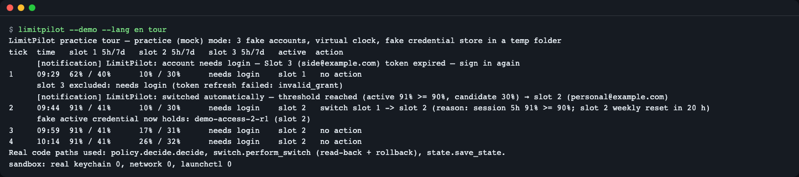
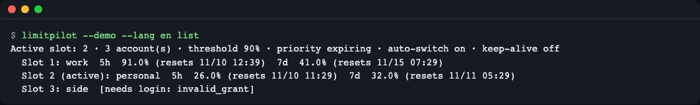
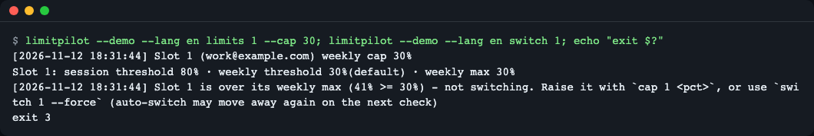
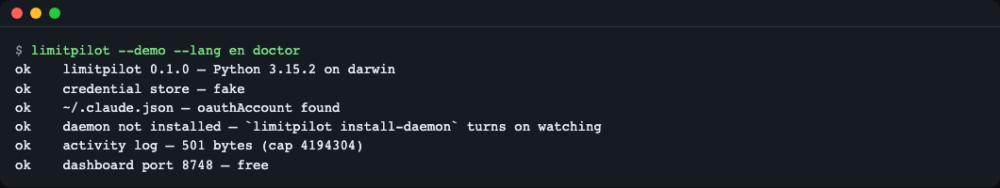
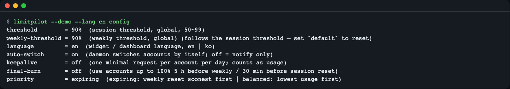
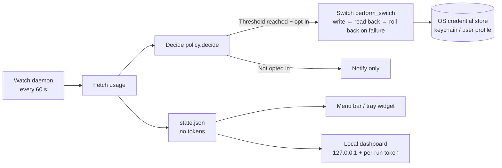
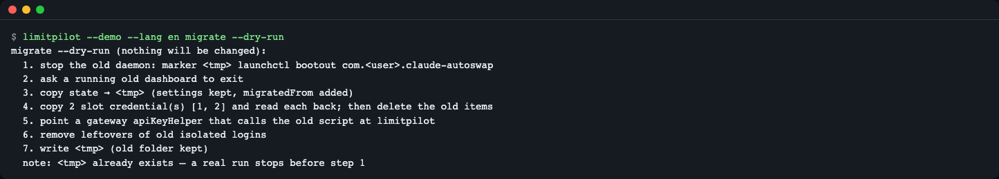

# LimitPilot

**English** | [한국어](README.ko.md)

LimitPilot shows how much of each of *your own* Claude Code subscription accounts' 5-hour and weekly usage is left — in the macOS menu bar, the Windows tray, a local dashboard, or `limitpilot list` — and, only if you opt in, a 60-second watcher switches to another of your accounts before the active one hits its limit.

Zero runtime dependencies (Python standard library; the menu bar app is compiled on your Mac with the Swift compiler that ships with macOS). Tokens stay in the OS credential store; every switch is written, read back and rolled back on mismatch.

Try it in 30 seconds without touching real credentials: `limitpilot --demo --lang en tour` (practice/mock mode). Install: `uv tool install git+https://github.com/LeeGyeongPil/limitpilot`.

## Result preview


*Practice (mock) mode tour. At the 2nd check (tick 2), slot 1 reaches 91% of its 5-hour usage and is swapped for slot 2, while slot 3, which needs to log in again, is dropped from the candidates. The last line confirms there were 0 real keychain, network, or `launchctl` calls.*

## One-line summary

**A desktop resident tool that gathers the remaining usage of several Claude Code subscription accounts you own onto one screen and, if you want, hands over to another account before one hits its limit.** The default is to send notifications only; it neither raises nor bypasses any limit.

Who it's for:
- People with two or more Claude Code subscription accounts who keep logging out and in every time one account hits its limit
- People who want to see, right in the menu bar or tray, which account has how much left
- People who want to read the code themselves and use it without external packages, because the tool handles credentials (login tokens)

> Before using it, please read [Notes on use](#notes-on-use) and [Security notes](#security-notes).

## Why it's needed

Imagine carrying two or three transit cards. Every time the gate says "insufficient balance," you have to dig through your wallet for another card. If each card's balance is always visible on the outside of the wallet, and a nearly empty card is moved to the back in advance, that happens much less.

A Claude Code subscription account has a 5-hour usage window and a 7-day (weekly) usage window. LimitPilot keeps the remaining amount of both windows visible for every account (the outside of the wallet) and, if you want, swaps a nearly exhausted account for another one (swapping the card). Swapping means "replacing the login information with another account's," so misuse could tangle your login. That is why, after a swap, it reads the credentials back to verify them and rolls back if they differ.

## Install

Prerequisites: Python 3.10 or later, macOS or Windows. The menu bar app is built on your own PC with `swiftc`, which ships with macOS; the Windows tray app is built with `csc.exe`, which ships with Windows. Linux is not a supported target and is not checked in CI.

```bash
curl -LsSf https://astral.sh/uv/install.sh | sh        # Install uv (skip if you already have it)
uv tool install git+https://github.com/LeeGyeongPil/limitpilot
limitpilot --version
```
```text
limitpilot 0.3.1
```

You can also run it straight from the repository without installing (read `limitpilot` at the start of each command in this document as `PYTHONPATH=src python3 -B -m limitpilot`).

```bash
git clone https://github.com/LeeGyeongPil/limitpilot && cd limitpilot
PYTHONPATH=src python3 -B -m limitpilot --version
```

## 30-second run (practice mock mode)

`--demo` is the **practice mock mode**. It lets you see how the tool decides, without any real accounts.

```bash
limitpilot --demo --lang en tour
```
```text
LimitPilot practice tour — practice (mock) mode: 3 fake accounts, virtual clock, fake credential store in a temp folder
tick  time   slot 1 5h/7d   slot 2 5h/7d   slot 3 5h/7d   active  action
1     09:20  62% / 40%      10% / 30%      needs login    slot 1   no action
      slot 3 excluded: needs login (token refresh failed: invalid_grant)
2     09:35  91% / 41%      10% / 30%      needs login    slot 2   switch slot 1 -> slot 2 (reason: session 5h 91% >= 90%; slot 2 weekly reset in 20 h)
      fake active credential now holds: demo-access-2-r1 (slot 2)
3     09:50  91% / 41%      17% / 31%      needs login    slot 2   no action
4     10:05  91% / 41%      26% / 32%      needs login    slot 2   no action
Real code paths used: policy.decide.decide, switch.perform_switch (read-back + rollback), state.save_state.
sandbox: real keychain 0, network 0, launchctl 0
```

The output above omits two `[notification]` lines and one line with the temp folder path. Times vary with when you run it.

| | Practice mode (`--demo`) | Real mode |
|---|---|---|
| Accounts | 3 fake accounts (`work`, `personal`, `side`) | The accounts you registered |
| Credential store | A fake store in a temp folder | macOS keychain / Windows user profile |
| Usage | A prepared scenario file (`demo/scenario.json`) | Claude usage lookup (network) |
| Clock | Virtual clock (advances 15 minutes per check) | Real clock, checked every 60 seconds |
| Real code that runs as-is | The switch decision (`decide`), switching, read-back and rollback (`perform_switch`), state saving | Same |
| Outside calls | Keychain, network, `launchctl` and browser are blocked and only counted | Actually called |

In real mode, the first usage lookup can take a few seconds to tens of seconds because of a network round trip and the keychain prompt. If the server answers 429 (too many requests), it waits and retries (backoff).

## Step by step

You can follow all of this in practice mode. It continues from the practice state built in the earlier steps (the state after the tour: active slot 2). The practice state lives in the `limitpilot-demo` folder inside the system temp folder (changeable with `LIMITPILOT_DEMO_ROOT`), and running `tour` again resets it to the starting state.

### Step 1 — Read usage per account

```bash
limitpilot --demo --lang en list
```
```text
Active slot: 2 · 3 account(s) · threshold 90% · priority expiring · auto-switch on · keep-alive off
  Slot 1: work  5h  91.0% (resets 11/10 12:30)  7d  41.0% (resets 11/15 07:20)
  Slot 2 (active): personal  5h  26.0% (resets 11/10 11:20)  7d  32.0% (resets 11/11 05:20)
  Slot 3: side  [needs login: invalid_grant]
```


*`list`: 5-hour (5h) and weekly (7d) usage and reset time for each slot, with the active slot marked*

What it means:
- A **slot** is a compartment that stores one account. `(active)` is the account Claude Code is using right now.
- `5h 91.0%` means 91% of the 5-hour usage window has been used, and `resets` is when that window is cleared.
- `needs login` means the saved token can no longer be used and you must log in again. That account is dropped from the auto-switch candidates.

### Step 2 — Turn on continuous watching (practice)

In real mode, `install-daemon` registers a 60-second watcher with the OS scheduler (macOS launchd, Windows Task Scheduler). The default is a mode that **only notifies and does not switch**; auto-switching turns on only when you separately consent with `--enable-auto`. Practice mode registers nothing and just tells you what it would do (exit code 0).

```bash
limitpilot --demo --lang en install-daemon --enable-auto
limitpilot --demo --lang en uninstall-daemon
```
```text
Practice mode: would register the background watcher with the OS scheduler (nothing was changed) - auto-switch turned on in the practice state
Practice mode: would remove the background watcher from the OS scheduler (nothing was changed)
```

You can check once what the watcher would do right now with `auto --once --dry-run`. Exit code 2 means "nothing to do."

```bash
limitpilot --demo --lang en auto --once --dry-run
```
```text
[2026-11-10 09:22:41] No action: below threshold (session 26%/90% · weekly 32%/90%)
```

`session 26%/90%` means "the active account's 5-hour usage is 26%, and the switch threshold is 90%."

### Step 3 — Set limits per account

Besides the global threshold (`threshold`), you can give each account its own session threshold, weekly threshold, and weekly maximum. The **weekly maximum (`--cap`)** is a safety ceiling meaning "if this account's weekly usage exceeds this value, do not use it as an auto-switch candidate." A manual `switch N` to a slot already over its maximum also stops with a warning (exit 3); add `--force` to switch anyway, and the dashboard asks "Switch anyway" instead.

```bash
limitpilot --demo --lang en limits 1 --session 80 --cap 70
```
```text
[2026-11-10 09:20:33] Slot 1 (work@example.com) weekly cap 70%
[2026-11-10 09:20:33] Slot 1 (work@example.com) limits changed: session 80% · weekly 70% · max 70%
Slot 1: session threshold 80% · weekly threshold 70%(default) · weekly max 70%
```

If you register an already-registered account again (for example, after its token expired and you logged in again), only the token changes; the alias and per-account limits stay. Practice-mode `add` re-registers slot 2, which is currently active, so you get `updated`, and the other slots' limits are not touched. For re-registering the same slot after setting its limits, see experiment 2 in [Try changing things](#try-changing-things).

```bash
limitpilot --demo --lang en add
limitpilot --demo --lang en limits 1
```
```text
[2026-11-10 09:20:33] Slot 2 updated: personal@example.com - signed in again; alias and per-account limits kept
Slot 1: session threshold 80% · weekly threshold 70%(default) · weekly max 70%
```

`list` also shows per-account limits: `Slot 1 [limits session 80·weekly 70·max 70%]: work ...`

**Switching by hand to a slot over its maximum.** Practice slot 1 has 41% weekly usage. If you lower its maximum to 30%, `switch 1` only warns and does not switch; it ends with exit code 3. `switch 1 --force` prints a similar warning ("... switching anyway (--force)") and switches (exit code 0). `switch` without a slot number has no such check: its automatic pick skips accounts that are over their maximum (or fully used up). If no other account is left, it prints a message and exits with code 1 instead of switching (v0.1.3 and earlier could still pick such a slot).

```bash
limitpilot --demo --lang en limits 1 --cap 30
limitpilot --demo --lang en switch 1
echo "exit $?"
limitpilot --demo --lang en switch
echo "exit $?"
limitpilot --demo --lang en cap 1 70
```
```text
[2026-11-10 09:20:33] Slot 1 (work@example.com) weekly cap 30%
Slot 1: session threshold 80% · weekly threshold 30%(default) · weekly max 30%
[2026-11-10 09:20:33] Slot 1 is over its weekly max (41% >= 30%) - not switching. Raise it with `cap 1 <pct>`, or use `switch 1 --force` (auto-switch may move away again on the next check)
exit 3
[2026-11-10 09:20:33] Every other account is at its limit or over its weekly max — nothing to switch to. Name a slot (`switch <slot>`) to pick one anyway
exit 1
[2026-11-10 09:20:33] Slot 1 (work@example.com) weekly cap 70%
```



_Figure: `switch 1` to a slot over its weekly max warns and stops with exit code 3._

### Step 4 — Add a new account and keep-alive calls (practice mode notes)

`login` signs in to another account in the browser and saves it in an empty slot (the account you are using now does not change). `keepalive` sends one tiny request per account to keep its token alive. Both reach outside your machine, so practice mode only tells you what it would do and ends (exit code 0, no failure recorded in the practice state).

```bash
limitpilot --demo --lang en login
limitpilot --demo --lang en keepalive
```
```text
Practice mode: would run `claude auth login` in an isolated folder and save the new account to a backup slot (nothing was changed). Run without --demo to add a real account.
Practice mode: would send one minimal request per account (max_tokens=1) for slot(s) 1, 2 (nothing was sent)
```

### Step 5 — Register a third-party gateway as a manual-only slot

If you register an Anthropic-compatible gateway (such as a proxy you run yourself) as a slot, it is used only when you pick it directly with `switch`. It has no usage window, so it never becomes an auto-switch candidate.

`gateway-add` reads **`gateway.local.env` in the current folder**. Point to another file with `--env-file <path>`. The format is one `KEY=VALUE` per line (the values below are placeholders).

```dotenv
# gateway.example.env
ANTHROPIC_BASE_URL=https://gateway.example.com
ANTHROPIC_MODEL=example-model
ANTHROPIC_AUTH_TOKEN=replace-me
GATEWAY_ALIAS=my-gateway
```

| Key | Required | Meaning |
|---|---|---|
| `ANTHROPIC_BASE_URL` | Yes | Gateway address. Only `https://` is accepted, and an address containing a username or password is rejected |
| `ANTHROPIC_MODEL` | Yes | Model name to use on that gateway |
| `ANTHROPIC_AUTH_TOKEN` | Yes (default mode) | Bearer token. If the gateway uses the `x-api-key` style, write the two lines `GATEWAY_AUTH_MODE=api-key` and `ANTHROPIC_API_KEY=<key>` instead |
| `GATEWAY_ALIAS` | No | Name shown in the list (the model name if absent) |

Lines starting with `#` are skipped as comments. A comment placed after a value becomes part of the value, so don't write one. The default file name `gateway.local.env` is in this repository's `.gitignore`. It holds a token, so do not commit or share it.

```bash
limitpilot --demo --lang en gateway-add --env-file gateway.example.env
limitpilot --demo --lang en list
```
```text
[2026-11-10 09:20:34] Slot 4 gateway added: my-gateway (example-model)
Active slot: 2 · 4 account(s) · threshold 90% · priority expiring · auto-switch on · keep-alive off
  Slot 1 [limits session 80·weekly 70·max 70%]: work  5h  91.0% (resets 11/10 12:30)  7d  41.0% (resets 11/15 07:20)
  Slot 2 (active): personal  5h  26.0% (resets 11/10 11:20)  7d  32.0% (resets 11/11 05:20)
  Slot 3: side  [needs login: invalid_grant]
  Slot 4: my-gateway  third-party gateway · example-model · https://gateway.example.com · manual only
```

If the file is missing or a key is absent, it tells you what to fix. Key values are never printed in the error (`<폴더>` in the path is actually the current folder; it means "folder").

```text
Error: The gateway env file <폴더>/gateway.local.env does not exist. Create it with KEY=VALUE lines: ANTHROPIC_BASE_URL=https://<gateway>, ANTHROPIC_MODEL=<model>, ANTHROPIC_AUTH_TOKEN=<token> (or GATEWAY_AUTH_MODE=api-key with ANTHROPIC_API_KEY=<key>), optional GATEWAY_ALIAS=<name>. Or point to another file with --env-file <path>.
Error: <폴더>/partial.env is missing ANTHROPIC_MODEL, ANTHROPIC_AUTH_TOKEN - add them as KEY=VALUE lines (ANTHROPIC_BASE_URL must be an https URL)
```

### Step 6 — Check the environment

```bash
limitpilot --demo --lang en doctor
```
```text
ok    limitpilot 0.3.1 — Python 3.15.2 on darwin
ok    credential store — fake
ok    ~/.claude.json — oauthAccount found
ok    daemon not installed — `limitpilot install-daemon` turns on watching
ok    activity log — 624 bytes (cap 4194304)
ok    dashboard port 8748 — free
```


*`doctor`: checks the install, credential store, Claude Code login file, daemon, log, and dashboard port, one line each. In practice mode the store shows as `fake` (the Python version and log size vary by environment)*

### Step 7 — Dashboard and menu bar widget

```bash
limitpilot --demo --lang en dashboard --no-open
```
```text
Dashboard started: http://127.0.0.1:8748/ (DEMO - practice mock mode)
```

Open the printed address in a browser to see, with fake data, the account cards (threshold, weekly maximum, status badge), the auto-switch on/off control, and the add-account panel. The dashboard opens only on `127.0.0.1` and uses a new API token every time it runs. If you run it without `--no-open`, practice mode does not open a browser itself; it prints `Practice mode: open http://127.0.0.1:8748/ in your browser yourself ...` and keeps serving. Press Ctrl+C to stop. The dashboard shows the configured language from its very first paint (saved `language` setting, then `--lang` / `LIMITPILOT_LANG`, then the OS locale, otherwise English).

The menu bar widget (macOS) is built and installed on your own PC with `limitpilot widget install`, and then opens from a menu bar icon (a gauge plus the active account's usage, such as `42%`). It shows per-account 5-hour and weekly bars and the next candidate. On Windows, the same command builds a tray app.

In the dashboard, the "Switch" button on a slot that is over its weekly max asks for confirmation first ("Over weekly max" / "Switch anyway"); confirming switches anyway, cancelling does nothing. The menu bar widget and the Windows tray call `switch N` without `--force`, so they show the same warning text instead of switching.

(This document does not yet include pictures of the dashboard or widget. The documentation capture environment could not launch a browser and native apps.)

### Machine-readable output (`--json`)

`limitpilot list --json` (and `status --json`, which is identical) prints one JSON document on stdout instead of the text table, so a status line, tmux, or a script can read usage without parsing text that changes with the language. Diagnostics and the migration notice stay on stderr. The text output without `--json` is unchanged. The keys and values do not depend on `--lang` or `LANG`, and reset times are the stored ISO 8601 strings (not local-formatted).

```bash
limitpilot --demo --lang en list --json
```

```json
{"schemaVersion": 1, "version": "0.3.1", "activeSlot": 1, "slots": [
  {"slot": 1, "label": "work", "active": true, "enabled": true, "kind": "oauth", "status": "ok",
   "fiveHour": {"pct": 62.0, "resetsAt": "2026-11-12T06:45:22.583089Z"},
   "sevenDay": {"pct": 40.0, "resetsAt": "2026-11-17T01:35:22.583089Z"}},
  {"slot": 3, "label": "side", "active": false, "enabled": true, "kind": "oauth", "status": "quarantined",
   "fiveHour": null, "sevenDay": null}]}
```

(The real output is a single line; it is wrapped here for reading, and the middle slot is omitted. The values are from a fresh practice state, before `tour`. After `tour` the active slot is 2 and slot 1 shows 91.0%/41.0%. The reset times differ on every run.)

| Key | Meaning |
|---|---|
| `schemaVersion` | Integer, currently `1` |
| `version` | LimitPilot version |
| `activeSlot` | Active slot number, or `null` |
| `slots[].slot`, `label`, `active`, `enabled` | Slot number, the same label as the text output, whether it is the active slot, whether it is enabled (not `[OFF]`) |
| `slots[].kind` | `oauth`, `setup-token`, `gateway`, or `enterprise` |
| `slots[].status` | `ok`, `partial`, `snapshot` (last saved usage, live lookup failed), `token-expired`, `quarantined`, or `unknown` (also gateway and setup-token slots, which have no usage) |
| `slots[].fiveHour`, `sevenDay` | `{"pct": number, "resetsAt": ISO 8601 string or null}`, or `null` when there is no data |

Never included: tokens, API keys, gateway URLs, quarantine reasons, or other free text. No registered slots is not an error (`"slots": []`, exit code 0). `list` may refresh usage over the network, as before. On an error the document is `{"schemaVersion": 1, "error": {"code": "...", "message": "..."}}` on one stdout line, the usual error line stays on stderr, and the exit code is 1; `code` is `error`, `sandbox`, `unexpected`, or `unsupported-platform`. A bad argument still exits with code 2 and a message on stderr only.

Compatibility: adding new keys keeps `schemaVersion`; renaming or removing a key raises it. Read the keys you need and ignore the rest.

### Getting started with real accounts

```bash
limitpilot add                            # Register the account currently logged in to Claude Code in a slot
limitpilot login                          # Add another account via the browser (the active account stays)
limitpilot list                           # View usage per account
limitpilot install-daemon                 # Check every 60 seconds, notify only
limitpilot install-daemon --enable-auto   # Explicitly consent to auto-switching too
limitpilot widget install                 # Build and install the menu bar (tray) app
limitpilot dashboard                      # Open the local dashboard
```

> `add`, `login`, `install-daemon`, `widget install`, `dashboard`, and `migrate` (real mode) touch the real PC (keychain, launchd, Task Scheduler, login items, browser). The output in this document was checked only with practice mode and read-only commands, and the real-mode output of the commands above is not reproduced here.

## Usage

| Command / option | What it does | Example |
|---|---|---|
| `add` | Register the currently logged-in active account in a slot. If the account already exists, only the token is refreshed and the alias and per-account limits are kept | `limitpilot add` |
| `login [--alias name]` | Add a new account via the browser (active account unchanged). Refreshes it if it already exists | `limitpilot login` |
| `gateway-add [--env-file path] [--alias name]` | Register the gateway from the env file ([Step 5](#step-5--register-a-third-party-gateway-as-a-manual-only-slot)) in a manual-only slot | `limitpilot gateway-add` |
| `remove` / `enable` / `disable` | Unregister a slot / include it in / exclude it from the auto-switch candidates | `limitpilot disable 3` |
| `list`, `status` [`--json`] | Show usage and status; `--json` prints a machine-readable JSON document ([format](#machine-readable-output---json)) | `limitpilot list --json` |
| `refresh` | Refresh usage immediately | `limitpilot refresh 2` |
| `switch [slot] [--force]` | Switch (if no slot is given, the account the tool picks). A named slot already over its weekly max is refused (exit 3) unless you add `--force` | `limitpilot switch 2` |
| `auto [--once] [--dry-run]` | A loop that watches every 60 seconds (foreground, end with Ctrl+C). `--once` runs a single time; `--dry-run` shows the decision without switching | `limitpilot auto --once --dry-run` |
| `limits slot [--session N --weekly N --cap N]` | Per-account session threshold, weekly threshold, and weekly maximum (revert with `default`) | `limitpilot limits 1 --session 80` |
| `cap slot N` | Per-account weekly maximum (%) | `limitpilot cap 1 70` |
| `keepalive` | Run the keep-alive call immediately | `limitpilot keepalive` |
| `config [key [value]]` | View or change settings | `limitpilot config auto-switch on` |
| `install-daemon [--enable-auto]` / `uninstall-daemon` | Register / remove continuous watching | `limitpilot install-daemon` |
| `dashboard [--port N] [--no-open] [--add]` | Local dashboard | `limitpilot dashboard --no-open` |
| `widget build\|install\|uninstall [--out DIR] [--dry-run]` | Menu bar (tray) app | `limitpilot widget build --out ./build` |
| `migrate [--dry-run]` | Move data from claude-account-pilot | `limitpilot migrate --dry-run` |
| `doctor` | Environment check | `limitpilot doctor` |
| `purge` | Completely delete the daemon, backups, state, and logs (you must type `PURGE` to proceed) | `limitpilot purge` |
| `--demo`, `--lang en\|ko` | Practice mode, output language (global options, placed before the command) | `limitpilot --demo tour` |

Exit codes: 0 success / switched · 1 error · 2 nothing to do (below threshold in `auto --once`) · 3 cannot switch (including a slot over its weekly max) · 4 deletion in progress. Invalid input gets a one-line explanation of how to fix it.

```bash
limitpilot --demo --lang en config threshold abc
limitpilot --demo --lang en remove 99
```
```text
[2026-11-10 09:20:32] Error: Threshold must be a number (got 'abc')
[2026-11-10 09:20:32] Error: Slot 99 is not registered
```

`--lang en` and `--lang ko` apply to almost all output of the Python package (command output, `doctor`, `migrate --dry-run`, `widget --dry-run`, logs, notifications, errors, dashboard responses). If not specified, the OS locale is followed (for example, `limitpilot gateway-add --help` shows Korean help under a Korean locale). The exceptions are the fixed Korean strings of the Windows tray (`tray.cs`, `tray.ps1`); the output of `migrate --purge-legacy`, a real `migrate` run, real `widget build` messages, and real `widget install` / `uninstall` messages; the `nothing to migrate` line of `migrate --dry-run` when no old data exists; and argparse's default text (`usage`, `options`, error messages) (all of these stay in English); as well as old lines already recorded in `state.json` and `limitpilot.log`.

## Settings

```bash
limitpilot --demo --lang en config
```
```text
threshold        = 90%  (session threshold, global, 50~99)
weekly-threshold = 90%  (weekly threshold, global) (follows the session threshold — set `default` to reset)
language         = en  (widget / dashboard language, en | ko)
auto-switch      = on  (daemon switches accounts by itself; off = notify only)
keepalive        = off  (one minimal request per account per day; counts as usage)
final-burn       = off  (use accounts up to 100% 5 h before weekly / 30 min before session reset)
priority         = expiring  (expiring: weekly reset soonest first | balanced: lowest usage first)
```


*`config`: the practice-mode screen. `auto-switch` is a value practice mode turned on for the tour; the default for a real install is `off`*

| Key | Default (real install) | What it does |
|---|---|---|
| `threshold` | 90% | When session (5-hour) usage reaches this value, look for a switch candidate (50~99) |
| `weekly-threshold` | Follows the session threshold | Weekly usage threshold |
| `auto-switch` | **off** | When on, the daemon switches by itself; when off, it only notifies |
| `keepalive` | **off** | When on, sends one minimal request per account per day to keep the token alive. This request counts as usage |
| `final-burn` | **off** | When on, uses that account up to 100% just before its reset (5 hours before the weekly reset, 30 minutes before the session reset) |
| `priority` | `expiring` | `expiring`: prefer the account whose weekly reset is soonest; `balanced`: prefer the account with the lowest usage |
| `language` | OS locale (en if none) | Widget and dashboard language `en\|ko` |

Environment variables (all optional): `LIMITPILOT_HOME` (state folder, default `~/.limitpilot`), `LIMITPILOT_PORT` (dashboard port, default 8748), `LIMITPILOT_LANG` (en|ko), `LIMITPILOT_SANDBOX=1` (blocks real keychain, launchctl, schtasks, and external HTTP calls and counts them). No API key is needed.

## How it works



1. **Watch daemon**: The OS scheduler (launchd or Task Scheduler) runs `limitpilot.pyz` (a single-file copy bundled just for the daemon) every 60 seconds.
2. **Fetch usage**: For each account, it gets the 5-hour and weekly usage and the reset times.
3. **Decide**: The policy code decides "leave it as is, or switch to whom" from the threshold, per-account limits, weekly maximum, and how soon the reset is.
4. **Switch or notify**: If auto-switching is on, it overwrites the active credentials, reads them back to verify, and rolls back if they differ. If it is off, it only sends a notification.
5. **Tokens in one place only**: Tokens exist only in the keychain (macOS) or a user-profile file (Windows). The `state.json` read by the widget and dashboard has only usage numbers and no tokens.
6. **Dashboard protection**: It opens only on `127.0.0.1` and accepts only requests that pass the per-run token and the Host and Origin checks.

If Claude Code's credential storage format changes, behavior may break. If something looks off, run `limitpilot doctor` first.

## Code tour

| File | Where to look | What you learn |
|---|---|---|
| `src/limitpilot/policy/decide.py` | `decide()` | The order in which a single check decides "stay / switch / blocked." It does not touch unmanaged accounts, expired tokens, or manual-only slots, and when usage is unknown it moves only after watching a few more times |
| `src/limitpilot/switch.py` | `perform_switch()` | The safe procedure for swapping credentials: lock → back up the current token into its own slot → write the target token → read back and compare → `rollback_active()` if different |
| `src/limitpilot/accounts.py` | `USER_SLOT_KEYS`, `_keep_user_settings()` | Where the user-set alias, thresholds, and weekly maximum are carried over when the same account is registered again. It keeps safety ceilings from being silently lifted |

What practice mode fakes can be seen in `src/limitpilot/demo/__init__.py` (the fake store and scenario responses) and `src/limitpilot/sandbox.py` (blocking and counting outside calls).

## Glossary

| Term | Meaning |
|---|---|
| Slot | A numbered compartment that holds one account's credentials and settings |
| Active account | The account Claude Code is using right now |
| 5-hour window / weekly window | The periods over which usage is counted. Each window is cleared at a fixed time (`resets`) |
| Threshold | The value at which the active account's usage triggers a switch review |
| Weekly maximum (cap) | A safety ceiling: if this account's weekly usage exceeds this value, it is dropped from the auto-switch candidates |
| Opt-in | Works only when the user explicitly turns it on (auto-switch, keep-alive, burn before reset) |
| Keep-alive call (keepalive) | A tiny request sent once a day per account to keep the token alive. It counts as usage |
| Burn before reset (final-burn) | An option that uses an account whose window is about to clear up to 100% just before the reset |
| Credential store | Where the OS keeps secret values. The macOS keychain; on Windows, the user profile folder |
| Read-back and rollback | After writing credentials, read them back to check they match, and restore the previous value if they don't |
| Gateway slot | A slot that uses a third-party Anthropic-compatible address. Manual switching only |
| Practice mock mode | `--demo`. A mode that runs the real code paths with fake accounts, a virtual clock, and a fake store |

## Try changing things

Start each experiment by running `limitpilot --demo --lang en tour` to reset the practice state to the beginning (the tour creates the practice state anew).

**Experiment 1 — Lower the global threshold**
- What to change: `limitpilot --demo --lang en config threshold 60`
- Expected result: The decision threshold changes from 90% to 60%. Active slot 2 is at 26%, so it still does not switch.
- How to check: `limitpilot --demo --lang en auto --once --dry-run`

```text
[2026-11-10 09:22:41] No action: below threshold (session 26%/60% · weekly 32%/60%)
```

**Experiment 2 — Does a per-account threshold beat the global one, and does it survive re-registering?**
- What to change: `limitpilot --demo --lang en limits 2 --session 80 --weekly 70`
- Expected result: Slot 2's decision thresholds become session 80% and weekly 70%, and they stay even after re-registering with `add`.
- How to check: `auto --once --dry-run` → `add` → `limits 2`

```text
[2026-11-10 09:22:42] No action: below threshold (session 26%/80% · weekly 32%/70%)
[2026-11-10 09:22:42] Slot 2 updated: personal@example.com - signed in again; alias and per-account limits kept
Slot 2: session threshold 80% · weekly threshold 70% · weekly max 100%
```

**Experiment 3 — Turn off auto-switching (notify only)**
- What to change: `limitpilot --demo --lang en config auto-switch off`
- Expected result: `auto-switch` in the first line becomes `off`. In this state the daemon only sends notifications even when a threshold is exceeded (the default for a real install).
- How to check: `limitpilot --demo --lang en list`

```text
[2026-11-10 09:22:18] Setting updated: autoSwitch = False
Active slot: 2 · 3 account(s) · threshold 90% · priority expiring · auto-switch off · keep-alive off
```

## Security notes

- **Token location**: On macOS, the keychain (service `limitpilot`); on Windows, the files `~/.limitpilot/slots/slot-N.json` under the user profile. Tokens do not appear in `state.json`, logs, or the dashboard screen.
- **Windows slot files are not encrypted.** They are protected only by the user profile folder permissions (ACL), the same level of protection as Claude Code's own `%USERPROFILE%\.claude\.credentials.json` ([Claude Code docs, Credential management](https://code.claude.com/docs/en/iam), checked 2026-11-10). DPAPI encryption is not implemented yet.
- **`gateway.local.env`** holds the gateway token. It is in this repository's `.gitignore`, but do not commit or share it when you keep it elsewhere either.
- **`gateway-key`** (a hidden command not shown in help; an `apiKeyHelper` for third-party gateways) prints the API key to standard output as is. If you run it directly in a terminal, the key stays on the screen and in scrollback and may be exposed through shell history, screen sharing, or log collection, so do not run it by hand.
- **The dashboard** opens only on `127.0.0.1` and creates a new API token each run and injects it into the page. Requests with a mismatched token, Host, or Origin are rejected. Do not leave the dashboard on in an environment where other user accounts share the same PC.
- **Delete everything**: `limitpilot purge` completely deletes the continuous-watch registration, the account backups (keychain items and slot files), and the settings, state, and logs. You must type `PURGE` to proceed, and it keeps your current Claude Code login and Claude settings and history.

## Known limitations

- Pressing Ctrl+C in the dashboard may print a `KeyboardInterrupt` traceback while it shuts down; the dashboard still stops.
- Pointing `LIMITPILOT_DEMO_ROOT` at a folder you created beforehand (even an empty one) fails with a traceback. Use a path that does not exist yet.
- The Korean warning always uses the particle "은" after the slot number (for example "슬롯 2은"), which is wrong for some numbers.
- In practice mode, usage values are re-read from the scenario after a manual switch, so other slots' usage can appear to change.

## Notes on use

- Follow each account's terms of service and plan conditions, and use this only with **accounts you own**. This tool shows usage and makes switching convenient; it does not raise any limit.
- `keepalive` and `final-burn` send requests that count as usage, so they are off by default. Check the [Settings](#settings) table before turning them on.
- If Claude Code's storage format changes, behavior may break. If something looks off, run `limitpilot doctor` first.

## Migrating from the previous tool

If your PC used the author's earlier personal project, claude-account-pilot, migrate once. First, look at the sequence without changing anything (practice-mode output).

```bash
limitpilot --demo --lang en migrate --dry-run
```
```text
migrate --dry-run (nothing will be changed):
  1. stop the old daemon: marker .../.claude-autoswap/.daemon-stopped, launchctl bootout com.<user>.claude-autoswap
  2. ask a running old dashboard to exit
  3. copy state → .../state/state.json (settings kept, migratedFrom added)
  4. copy 2 slot credential(s) [1, 2] and read each back; then delete the old items
  5. point a gateway apiKeyHelper that calls the old script at limitpilot
  6. remove leftovers of old isolated logins
  7. write .../.claude-autoswap/MIGRATED (old folder kept)
  note: .../state/state.json already exists — a real run stops before step 1
```


*`migrate --dry-run`: stop the old daemon first, copy and read back to verify, and only then delete the old items*

The final `note:` line always appears because practice mode creates a new state folder in advance. If limitpilot state already exists on a real PC, `migrate` stops before step 1. (Paths are shortened to `...`.) For the detailed steps, see [docs/migrating.md](docs/migrating.md) (Korean).

## When to use it

- When you want to read, and modify, code built on the standard library alone, with no external packages.
- When you want to see each account's remaining usage in the macOS menu bar or Windows tray and use opt-in auto-switching.
- If you want a terminal TUI, also take a look at [realiti4/claude-swap](https://github.com/realiti4/claude-swap).

## Troubleshooting

| Symptom | Cause | Fix |
|---|---|---|
| An account shows as `needs login` | Refreshing the saved token failed (`invalid_grant`) | Log in to that account again with `limitpilot login` (if it is the account currently logged in to Claude Code, log in again in Claude Code and then run `limitpilot add`). For the same account you get `Slot N updated: ... alias and per-account limits kept`, and the alias, thresholds, and weekly maximum stay as they were |
| It does not switch even though the threshold was exceeded | The default is `auto-switch off` (notify only) | `limitpilot config auto-switch on` or `install-daemon --enable-auto` |
| `gateway-add` says `... gateway.local.env does not exist` | There is no env file in the current folder | Create the file in the [Step 5](#step-5--register-a-third-party-gateway-as-a-manual-only-slot) format, or use `--env-file <path>` |
| `gateway-add` says `... is missing ANTHROPIC_MODEL ...` | A required key is missing from the env file | Add the key named in the error as a `KEY=VALUE` line (`ANTHROPIC_BASE_URL` must be https) |
| The `dashboard` port is in use | Another process is using 8748 | `limitpilot dashboard --port 8800` or `LIMITPILOT_PORT` |
| The dashboard shows the wrong language, or `Already running` is printed | A dashboard started earlier is still running, and its language (set when it started) is reused as is | Stop that dashboard (Ctrl+C), or start a new one on another port with `--port` |
| In practice mode, `install-daemon`, `login`, and `keepalive` print only `Practice mode: would ...` | Practice mode does not call the OS scheduler, `claude`, or the network | Run without `--demo` for the real action |
| The practice-mode dashboard does not open a browser | Practice mode does not launch other programs | Open the printed `http://127.0.0.1:<port>/` yourself |
| `Error: Blocked in practice mode: ...` | Practice mode blocks the real keychain, network, and system commands | Run without `--demo` if you need the real action |
| `limitpilot auto` prints "The watcher is stopped" and ends | Watching was stopped with `uninstall-daemon` | Turn it back on with `limitpilot install-daemon` |
| An unexpected one-line error (`... limitpilot doctor ...`) | An environment problem | Run `limitpilot doctor`; for a detailed traceback, run with `LIMITPILOT_DEBUG=1` |
| Old tool daemon warning | The old daemon is competing for the same credentials | `limitpilot migrate`; quit the old menu bar app yourself |

## Learn more

- [Claude Code docs — Identity and Access Management (Credential management)](https://code.claude.com/docs/en/iam): where Claude Code stores credentials (checked 2026-11-10)
- [realiti4/claude-swap](https://github.com/realiti4/claude-swap): a tool that solves the same problem with a TUI (checked 2026-11-10)
- Other similar tools (checked 2026-11-10): [Leuconoe/ClaudeCodeMultiAccounts](https://github.com/Leuconoe/ClaudeCodeMultiAccounts), [Dicklesworthstone/coding_agent_account_manager](https://github.com/Dicklesworthstone/coding_agent_account_manager), [claude-code-tools/claude-code-account-switcher](https://github.com/claude-code-tools/claude-code-account-switcher)
- Documents in this repository: [Migration details](docs/migrating.md) (Korean), [Performance figures](docs/performance.md) (Korean), [Release procedure](docs/releasing.md) (Korean)

## Development and contributing

```bash
uv run --no-project python -B -m unittest discover -s tests -t .
```
```text
Ran ... tests in ...s
OK (skipped=2)
```

The number of tests and the time change from version to version, so they are written as `...`. If you see an `OK (skipped=…)` line, it passed (a few more informational lines printed by the tests may follow). `skipped=2` means 2 browser-login tests were skipped in an environment that cannot create a pseudo-terminal (PTY); where a PTY is available, no tests are skipped and you get just `OK`. Tests run under a global guard that blocks real keychain, `launchctl`, and external socket calls. Icons are built with `scripts/build_icons.py`, performance figures come from `scripts/bench.py` (results in [docs/performance.md](docs/performance.md)), and the release procedure is in [docs/releasing.md](docs/releasing.md). Commit titles follow Conventional Commits. For vulnerabilities, see [SECURITY.md](SECURITY.md). Please leave bugs and suggestions as issues. The change log is [CHANGELOG.md](CHANGELOG.md).

## License

MIT. There is no runtime dependency, so no third-party code is bundled.
